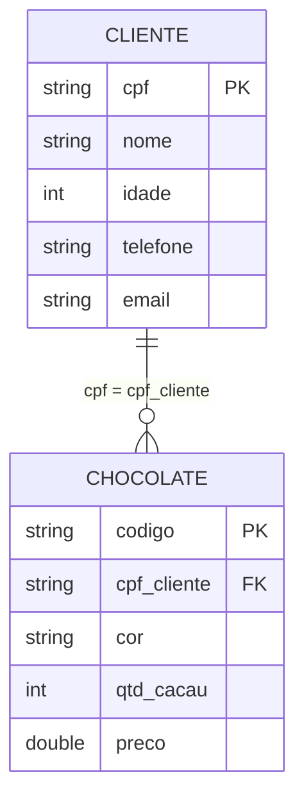

# 🍫 Fábrica de Chocolate

Aplicativo Android em Kotlin com Jetpack Compose para cadastrar **clientes** e os **chocolates** associados a eles, com persistência local em banco de dados (Room/SQLite).

> **Projeto acadêmico** desenvolvido na disciplina de Programação para Dispositivos Móveis, com o objetivo de praticar conceitos de desenvolvimento Android. Não é um produto pronto para uso em produção.


<!--
## Capturas de tela

Adicione as imagens em docs/screenshots/ e descomente este bloco.

| Tela inicial | Clientes | Chocolates |
|---|---|---|
|  |  |  |
-->

## Funcionalidades

- **Clientes:** inserir, listar, atualizar e excluir (CRUD completo).
- **Chocolates:** inserir, listar, atualizar e excluir, sempre vinculados a um cliente existente.
- **Validação de dados** antes de gravar no banco (veja as regras abaixo).
- **Navegação entre telas** com Navigation Compose.
- **Persistência local** com Room: os dados continuam disponíveis após fechar o app.
- Ao tocar em um item da lista, os dados são carregados nos campos do formulário para facilitar a edição ou exclusão.

### Regras de validação

| Entidade | Regras |
|---|---|
| Cliente | Todos os campos obrigatórios; idade maior que 0; CPF único |
| Chocolate | Todos os campos obrigatórios; código único; quantidade de cacau entre 20 e 90; preço maior que 0; o CPF informado deve pertencer a um cliente já cadastrado |

## Conceitos praticados

- Interface declarativa com **Jetpack Compose** e **Material 3** (`OutlinedTextField`, `Button`, `Card`, `LazyColumn`)
- Gerenciamento de estado local com `remember`, `mutableStateOf` e `mutableStateListOf`
- Efeitos colaterais com `LaunchedEffect`
- **Navigation Compose** (`NavHost`, `composable`, `NavController`)
- Persistência com **Room**: `@Entity`, `@Dao`, `@Database`, chave estrangeira com exclusão em cascata e índice
- Processamento de anotações com **KSP**
- **Coroutines** (`suspend fun`) e `viewModelScope`
- Separação em camadas: Model, Repository, ViewModel, Controller e View
- Injeção de dependências manual via construtor

## Arquitetura

Fluxo de uma operação, da tela até o banco:

```
View (Compose) → Controller (validação) → ViewModel (coroutines) → Repository → DAO → Room / SQLite
```

Estrutura do projeto:

```
FabricaChocolate/
├── app/
│   ├── build.gradle.kts
│   └── src/
│       ├── main/
│       │   ├── AndroidManifest.xml
│       │   ├── res/
│       │   └── java/com/example/fabricachocolate/
│       │       ├── MainActivity.kt      # cria o banco, monta as dependências e define a navegação
│       │       ├── models/              # entidades Room e DAOs
│       │       ├── dataBase/            # AppDatabase
│       │       ├── repositorys/         # repositórios
│       │       ├── viewModels/          # ViewModels
│       │       ├── controllers/         # validações e regras de negócio
│       │       ├── views/               # telas em Compose
│       │       └── ui/theme/            # tema Material 3
│       ├── test/                        # teste de exemplo (template do Android Studio)
│       └── androidTest/                 # teste instrumentado de exemplo (template)
├── gradle/libs.versions.toml            # catálogo de versões
├── build.gradle.kts
└── settings.gradle.kts
```

### Telas

| Rota | Tela | Descrição |
|---|---|---|
| `principal` | `TelaPrincipal` | Boas-vindas e acesso a Clientes e Chocolates |
| `cadastroCliente` | `CadastroCliente` | Formulário e lista de clientes |
| `cadastroChocolate` | `CadastroChocolate` | Formulário e lista de chocolates |

## Modelo de dados

Banco `banco_fabrica` (versão 1) com duas tabelas. Um cliente pode ter vários chocolates; ao excluir um cliente, os chocolates dele são excluídos em cascata.



## Tecnologias e versões

| Item | Versão |
|---|---|
| Kotlin | 2.2.10 |
| Android Gradle Plugin | 9.5.1 |
| Gradle (wrapper) | 9.6.0 |
| Compose BOM | 2026.02.01 |
| Navigation Compose | 2.10.2 |
| Room | 2.8.5 |
| KSP | 2.3.12 |
| `minSdk` | 35 (Android 15) |
| `compileSdk` / `targetSdk` | 37 |

## Como executar

### Pré-requisitos

- Uma versão do [Android Studio](https://developer.android.com/studio) compatível com o AGP 9.5.1 (a versão estável mais recente é a opção mais segura)
- Emulador ou dispositivo com **Android 15 (API 35) ou superior**
- Conexão com a internet na primeira sincronização: o Gradle baixa o wrapper 9.6.0, as dependências e o JDK definido em `gradle/gradle-daemon-jvm.properties` (resolvido automaticamente pelo plugin Foojay)

### Passo a passo

1. Clone o repositório:
   ```bash
   git clone https://github.com/JoaoGabrielRochaSilva/FabricaChocolate.git
   ```
2. No Android Studio, abra a pasta `FabricaChocolate` (**File > Open**).
3. Aguarde a sincronização do Gradle. O arquivo `local.properties`, com o caminho do Android SDK, é gerado automaticamente.
4. Selecione um emulador ou dispositivo com API 35+ e clique em **Run ▶**.

Alternativa pela linha de comando (com um dispositivo ou emulador conectado, e o SDK configurado em `local.properties` ou na variável `ANDROID_HOME`):

```bash
./gradlew installDebug      # Linux/macOS
gradlew.bat installDebug    # Windows
```

## Como usar

1. Na tela inicial, escolha **Clientes** ou **Chocolates**.
2. Cadastre primeiro ao menos um cliente: todo chocolate exige o CPF de um cliente existente.
3. Preencha o formulário e use **Inserir**, **Atualizar** ou **Excluir**. Atualizar e excluir identificam o registro pela chave (CPF do cliente ou código do chocolate).
4. Toque em um item da lista para carregar os dados dele nos campos.
5. Use **Voltar** para retornar à tela anterior.

## Limitações conhecidas

Por ser um projeto de estudo, alguns pontos foram deixados simples:

- O resultado das operações (sucesso ou erro) é registrado apenas no Logcat; a interface não exibe mensagens ao usuário.
- Os campos do formulário são limpos após cada ação, mesmo quando a operação falha.
- O CPF não passa por validação de formato nem tem máscara, e o preço usa ponto como separador decimal (por exemplo, `12.50`).
- O banco, os repositórios e os controllers são criados manualmente na `MainActivity`, sem biblioteca de injeção de dependências, e os ViewModels são instanciados diretamente.
- Os únicos testes são os exemplos gerados pelo Android Studio; as regras de negócio ainda não têm testes automatizados.

## Autor

Desenvolvido por João Gabriel como projeto acadêmico de Programação para Dispositivos Móveis.
